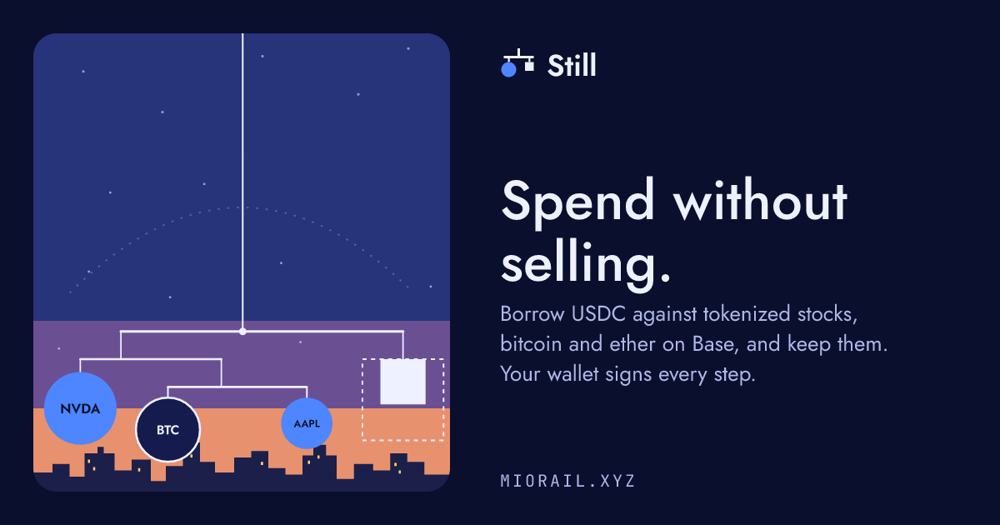

# Still · Miorail

> **Still: spend without selling.** Borrow USDC against your tokenized stocks, bitcoin, ether and gold on Base, keep them, and sign every step in your own wallet.



- **Try it:** [miorail.xyz](https://miorail.xyz). Check any Base wallet without signing in: `https://miorail.xyz/w/<address or name>`.
- **Live on Base mainnet** (`8453`). Loans live in Aave V4 and Morpho Blue, under your own wallet. Still deploys no contracts and never holds your collateral or your USDC.
- **Read the rules first:** [Loan safety](https://miorail.xyz/safety) · the terms as JSON: [`/api/public/still/terms`](https://miorail.xyz/api/public/still/terms)
- **For assistants:** `https://miorail.xyz/mcp/still`, read-only, no sign-in
- **Licence:** AGPL-3.0-only · **Security bugs:** report them privately, as [SECURITY.md](SECURITY.md) says, never as a public issue

Offered only in eligible jurisdictions: not to US persons, and not in the United States, Cuba, Iran, North Korea, Syria, Crimea or the so-called Donetsk and Luhansk People's Republics. A loan creates debt, and its collateral can be liquidated.

## What Still does

Still turns what a Base wallet holds into a USDC credit line, without selling it.

| Collateral | Where the loan lives |
| --- | --- |
| Coinbase tokenized stocks: AAPLc, AMZNc, GOOGLc, METAc, MSFTc, NVDAc, SPCXc, TSLAc | Aave V4, the Coinbase Stocks spoke |
| cbBTC | Morpho Blue, cbBTC/USDC |
| WETH, or native ETH wrapped in the same transaction | Morpho Blue, WETH/USDC |
| PAXG, Paxos's gold token | Morpho Blue, PAXG/USDC, priced by Chainlink XAU/USD |

```text
your wallet ── signs ──▶ Aave V4 / Morpho Blue on Base      the loan, recorded under your wallet
     ▲
     │  exact calls: decoded, simulated on a fresh block, Still's limit checked
Still server ── reads Base at one block, prepares and reviews; holds no key and no funds
```

- **Home** reads the wallet at one Base block and says, in dollars, how much it could borrow and how safe its loans are. A read that failed is called unread, never shown as zero.
- **Get money** (`/borrow`) takes the collateral and the amount you choose, prepares the exact calls, simulates them, and enforces Still's limit on the server before your wallet opens.
- **Repay** (`/repay`) pays an exact amount or all of it, and can take the collateral back in the same review.
- **Spend** (`/spend`) shows what a loan could pay for at Bitrefill (eSIMs, phone top-ups, gift cards), priced in USDC, and pays one invoice of up to 100 USDC: with a loan in the same transaction, or from USDC already in the wallet.
- **Agent** (`/agent`) answers questions about your own wallet. A what-if ("what if NVDA falls 30%?") is the engine's arithmetic, not a model's guess. It never signs or sends.
- **Alerts:** a connected Telegram chat is told when a loan's margin falls below 37.5%, below 20%, and when it can be liquidated.

Your own wallet signs every step: Base Account, Coinbase Wallet, MetaMask, Rabby, or any wallet through WalletConnect. A wallet that cannot send a batch gets the same loan in steps, one transaction each, and the server reads each landed step from Base before it asks for the next. Still adds no fee to a loan or a repayment, and every Still loan transaction carries its ERC-8021 Builder Code.

A shared link previews as its own card: `/w/<wallet>` as that wallet's check, and a confirmed purchase as the product, its price, the collateral and the protocol, never the wallet.

## How Still sets a limit

1. It reads each asset's collateral factor from the protocol itself, at one Base block.
2. It lends at **50%** of that factor. At Still's full limit, a new loan's collateral can lose about half its value before liquidation can start; interest narrows that over time.
3. For a stock it lends at **40%** while Wall Street is closed (weekends and market holidays, by a reviewed calendar) and from the day before a company's earnings report to the evening after it, when a price can gap. An earnings calendar that cannot be read, or that leaves a stock out, counts that stock at 40%.
4. A stock whose reference price has gone more than 25 hours of open market without an update also counts at 40%, until a new price arrives.
5. It leaves 0.0005 ETH in the wallet for network fees and never counts it.
6. The server refuses a loan above that limit, whatever the screen sent.

The terms are versioned and live in [`lib/still-engine/src/policy.ts`](lib/still-engine/src/policy.ts). Still's limit is not a recommendation to borrow.

## Who Still is for

Coinbase's tokenized stocks are available only to persons in eligible jurisdictions outside the United States, and Still follows that. Before the server hands out the calls of a new loan, a Spend purchase or a stock buy, it reads which country the connection comes from by its IP address ([IP geolocation by DB-IP](https://db-ip.com)) and refuses the United States and its territories, and Cuba, Iran, North Korea and Syria, which are under comprehensive US sanctions. Everyone else confirms once per sign-in: "I am not a U.S. person, and I am not currently located in the United States, Cuba, Iran, North Korea, Syria, Crimea, or the so-called Donetsk or Luhansk People's Republics." An IP address cannot tell those three regions apart from the rest of Ukraine, so for them the sentence is the check. A link an assistant prepares is checked when the person opens it in their own browser.

What closes a position is never blocked: from anywhere, a wallet can repay its loan, take its collateral back and sell.

## See it for yourself

Nothing here needs an account or a key:

- Still's terms in force now, with the windows open now and each stock's next earnings date: [miorail.xyz/api/public/still/terms](https://miorail.xyz/api/public/still/terms)
- The public check of any Base wallet: `https://miorail.xyz/w/<address or name>`
- How Still keeps a loan safe, for people: [miorail.xyz/safety](https://miorail.xyz/safety)
- The same reads from an assistant: add `https://miorail.xyz/mcp/still` as a connector in Claude, ChatGPT, Grok or Cursor

Every answer names the Base block it was read at, so anyone can read the same contracts at that block and compare.

## Why borrow through Still, and not from Aave or Morpho directly

Still is not a lender. It never holds collateral or USDC, and it adds no fee to a loan or a repayment. A Still loan *is* an Aave V4 or Morpho loan: the wallet supplies its collateral and borrows directly from the protocol, and the position is recorded there, under that wallet, where the protocol's own app can manage it as well.

So the real question is what the layer on top adds, because it has to earn the risk it brings. Today it adds four things.

1. **A limit that knows it is lending against stocks.** A protocol's collateral factor is the same at every hour of the week; a stock's risk is not. While Wall Street is closed, on weekends and market holidays, the token keeps trading on Base but its reference price stands still, and the next session can open with a gap. Around a company's earnings report the price can jump either way. Still lends at 50% of the protocol's own factor, and at 40% for a stock while the market is closed, around that company's report, or while its price feed has stopped refreshing. Borrowing the protocol's full maximum, the smallest fall in price can start liquidation. Borrowing Still's full limit, the collateral can fall 50% before it can, or 60% in those windows. That margin is protection the protocol itself does not give.
2. **One answer to "how much can I borrow?"** Every stock and crypto asset in the wallet is counted together, in dollars and plain words, read at one Base block. A read that failed is said to be unread, never shown as zero.
3. **A check before anything is signed.** Every loan is simulated on a fresh block before the wallet opens, every call is decoded, and the amounts are exact. The server enforces Still's share, and on Morpho the wallet calls Morpho Blue itself, so nothing is authorized to act for it.
4. **Company after the loan.** The Agent answers what-ifs with the engine's arithmetic. Still also shows which dividends reach the token and keeps track of the stock market's hours, and a connected Telegram chat is told, once per step, when a loan's margin falls below 37.5%, below 20%, and when it can be liquidated.

Get money shows the first point as numbers before the amount is chosen: the protocol's own limit beside Still's, how far the collateral could fall at each, and, when a stock counts lower, why and until when.

Someone at home in Aave or Morpho gains little from this. Still is for people who hold tokenized stocks, are not DeFi specialists, and want to borrow against their shares without selling them.

## What Still does not protect you from

- **Liquidation.** Still's limit keeps a new loan far from it, not out of reach. A fall in price, interest over time or more borrowing can bring a loan to liquidation; liquidators act through the protocol, and Still cannot stop them.
- **The protocols.** A Still loan is an Aave V4 or Morpho Blue position. Their contracts, oracles and rates apply; a loan that SPCXc covers also pays Aave's risk premium, up to 10% of the rate.
- **Prices that stand still.** Stock reference prices hold while Wall Street is closed, and PAXG is priced by Chainlink XAU/USD, which holds while the gold market is closed. The next open can gap.
- **Your own approval.** Still shows you what a transaction does. If you sign it, it happens.
- **A compromised wallet or device.** Nothing here helps if someone else controls the signer.

## Still for assistants

| Server | Sign-in | What it can do |
| --- | --- | --- |
| `https://miorail.xyz/mcp/still` | none | Still's terms, the public check of any Base wallet, what-ifs by Still's own engine, and what a loan could buy at Bitrefill. Read-only. |
| `https://miorail.xyz/mcp` | none | Tokenized-stock evidence, B20 measurements and Still's terms. Read-only. |
| `https://miorail.xyz/mcp/private` | OAuth 2.1 with your wallet | Every `/mcp` read and Still's Bitrefill reads, plus tools bound to the wallet that signed in: its own Still report, and review links for a loan, a repayment, a purchase, a stock buy or sale, or a swap. Another wallet's check and a what-if stay on `/mcp/still`. |

No server signs or sends anything. A tool that prepares an action returns a five-minute link to the same review page Get money opens, bound to your wallet; you check it and sign it there. A loan, a repayment and a purchase it links are reviewed by the same server checks as Get money and Repay, Still's limit included. A chat that draws MCP Apps, as Claude does, shows that review as Still's card. Tool names, inputs and what each answer guarantees: [docs/MCP.md](docs/MCP.md).

## Miorail underneath

Still is built on Miorail, which measures tokenized assets on Base before anyone acts on them.

- **Stocks** (`/stocks`): one company can be held on Base through several contracts (Coinbase's B20 tokens, Backed bTokens, Dinari dShares), and they do not trade alike. Miorail measures each exact address at one exact size: what a sale into USDC would return now, and its dividends.
- **Swap AI** (`/routes`): describe a swap in words; Miorail compares the routes it supports, simulates the chosen one, and your wallet signs it. Afterwards it reconciles what you expected with what landed.
- **Discover** (`/opportunities`): measurements of new B20 launches. It is not a screener and predicts nothing. [docs/B20_INTELLIGENCE.md](docs/B20_INTELLIGENCE.md)

One rule runs through all of it: **no data, no score.** A measurement that did not happen is never shown as zero, safe, or a recommendation.

On a stock's card the two questions are kept apart: *is there an answer right now* (a router quote is open for about twenty seconds, and past that the card says `Price expired`) and *what that answer costs*, graded against the reviewed slippage policy, so a round trip that returns $0.94 on $1,000 is never drawn in the colour of a good market. Every absence says whose it is: `No cash route found` is the market, `This route source does not cover this token` is Miorail's coverage, `Venue declined to quote` is the venue's own rule, and `Our read failed` is ours. On 2026-09-04, measured at a $1,000 sale into USDC, 10 of the then 13 Coinbase representations held a cash route, against 2 of 21 Backed and 0 of 96 Dinari: the same company, different contracts, a different market.

In the Base App and in Farcaster, the mini app is Still itself: the manifest at `https://miorail.xyz/.well-known/farcaster.json` opens `https://miorail.xyz/`, and the wallet the app already holds signs in place.

## Execution boundary

- Miorail never stores a user's private key, signs for the user, or broadcasts a raw transaction from the server.
- The server builds exact unsigned calls; the person's own wallet signs them and sends them itself.
- The client never supplies route calldata, router, recipient, spender, deadline, or minimum output.
- Blueprint hashes bind intent, candidate, evidence, approved calls, wallet, chain, and expiry.
- Provider output is independently decoded and checked before wallet approval.
- Receipt success alone is insufficient. A Route Proof reconciles expected and actual asset and position changes, and gas.
- RPC URLs, secrets, approval URLs, paid response bodies and delivery secrets do not enter public evidence or rendered traces.
- Before a tokenized-stock clearance is minted, the token's own onchain transfer policy is asked about that exact wallet, and a measured denial refuses. It is the issuer's own per-address rule; where Still is offered is a separate check, above.
- An assistant can prepare a review and can never confirm one. The clearance that authorises asking for an unsigned request is minted only in a person's own session, against terms the server re-established at that moment, and it expires in minutes.
- The public Builder Code travels as an optional `dataSuffix` capability on `wallet_sendCalls`. A wallet that does not name that capability gets the same ERC-8021 suffix appended to each call's data, which the contracts ignore; a call that already carries the code is never suffixed twice. Attribution never changes what a call does and never blocks a transaction.

More in [docs/SECURITY-MODEL.md](docs/SECURITY-MODEL.md).

## Proven on Base mainnet

Swaps have completed owner-verified journeys in both directions, each reconciled into a Route Proof:

```text
USDC → ETH → Route Proof reconciled
ETH  → USDC → Route Proof reconciled
```

A tokenized-stock buy settled through the surface it was designed for: an assistant prepared it and could not sign it.

```text
ChatGPT → private MCP → prepare → the owner's own wallet signed it
tx    0xfa730a78719cad081ffe2b0690498858eef4efa5a61a74f05ff0166ff3e7f6fb
block 50,884,282
in    100,000 atoms USDC  ($0.100000)
out    43,417 atoms NVDAc (expected 43,435, minimum 43,217)
```

One buy, of the primary representation, at ten cents. What it establishes is the chain of custody over the request: the assistant never held a key, never wrote calldata, and never broadcast. Public product metrics, with exact definitions: [miorail.xyz/metrics](https://miorail.xyz/metrics).

## Repository map

The product name is Miorail; the `@mioagent/*` package namespace remains for compatibility.

| Path | Responsibility |
| --- | --- |
| `artifacts/api-server` | Express API, authenticated product routes, the three MCP servers, workers, and reconciliation. |
| `artifacts/interface` | The Still web app at miorail.xyz, also the Base App and Farcaster mini app. |
| `artifacts/miniapp` | The earlier Next.js surface, served at `/app`. |
| `lib/still-engine` | Still's terms, the Mirror engine and its Morpho and Aave arithmetic. |
| `lib/route-domain`, `lib/route-storage` | Versioned contracts, stable hashes, additive persistence, and append-only proof history. |
| `lib/intent-engine`, `lib/route-engine`, `lib/route-card` | Typed intent, deterministic comparison, and Route Card projection. |
| `lib/swap-adapters`, `lib/earn-engine` | Provider-neutral swap adapters and Earn comparison. |
| `lib/security`, `lib/transaction-composer` | Safety Kernel and exact unsigned Blueprint construction. |
| `lib/route-proof`, `lib/proof-verifier` | Expected-versus-actual reconciliation and independent integrity verification. |
| `lib/opportunity-rail`, `lib/b20-control` | B20 measurement, controls, project claims, and Fundamental Intelligence. |
| `lib/rwa-market-reality`, `lib/rwa-issuer`, `lib/rwa-dossier` | Tokenized-stock identity, per-issuer adapters, market-reality comparison, use-and-access evidence, and the address dossier. |
| `lib/commerce-engine` | Bitrefill's catalogue and invoices, for Spend. |
| `lib/mcp`, `lib/tools` | Wallet MCP transport, classification, and constrained execution. |
| `lib/x402-gateway`, `lib/paid-intelligence`, `lib/intelligence-budget` | Paid evidence, reservations, charging, and reconciliation. |
| `lib/wallet-actions` | Wallet approval and submission, and ERC-8021 attribution. |
| `lib/ui`, `lib/api-zod`, `lib/api-client-react` | Shared screens and runtime-validated contracts. |

Which swap, earn and extension integrations are live, and how far each is proven: [docs/PLUGIN_REGISTRY.md](docs/PLUGIN_REGISTRY.md). It predates Still: Still's lending and Spend are described above.

## Contributing and security

- Contributing: [CONTRIBUTING.md](CONTRIBUTING.md)
- Security policy: [SECURITY.md](SECURITY.md). **Do not file security bugs as public issues.**
- What Miorail guarantees, and what it does not: [docs/SECURITY-MODEL.md](docs/SECURITY-MODEL.md)

## Safety notice

Miorail is experimental software. Evidence, measurements, project verification, and Route Proofs are not investment recommendations or guarantees of safety, liquidity, execution, or future value.

Do not use Miorail with funds you cannot afford to lose.

## Licence

Miorail is free software under the **GNU Affero General Public License v3.0**
(`AGPL-3.0-only`). See [LICENSE](LICENSE) and [NOTICE](NOTICE).

The practical consequence, since Miorail is normally run as a network service:
**if you run a modified Miorail and other people use it over a network, they
are entitled to your modified source.** Using it privately, or reading and
learning from the code, carries no such obligation.

The hosted instance at [miorail.xyz](https://miorail.xyz) offers its source in
the console footer, as §13 requires.

"Miorail" is the project's name, and the licence grants no trademark rights.
Fork it freely; call your fork something else.

## Authorship

Miorail is maintainer-directed and developed with extensive AI-assisted
engineering. The commit history says so as it happened: most commits carry the
identity of the AI coding assistant that wrote them, beside the maintainer's
own, `Miorail Development` for an earlier agent's work, and CI's. One person
directs the work and is accountable for it; the assistants are instruments, not
contributors.

Every claim this repository makes about what Miorail measured is expected to be
reproducible from the code and the evidence it stores, whoever or whatever
typed it.
